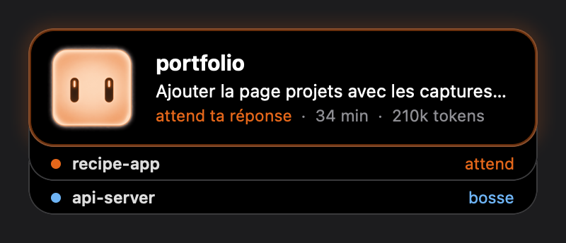
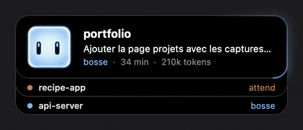
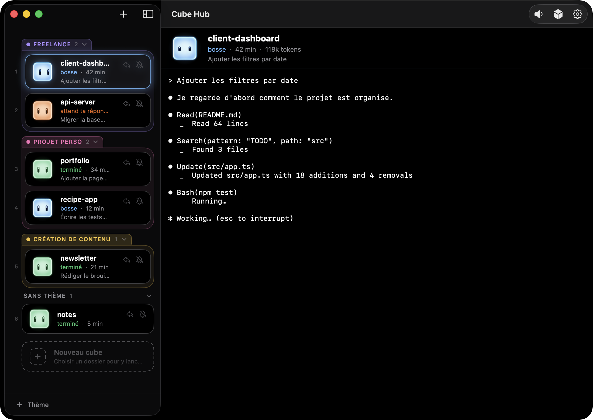

<div align="center">


# Cube Hub

**All my [Claude Code](https://claude.com/claude-code) sessions, at a glance, right on my Mac.**
A stack of cards and a little animated ice cube that tells me when Claude is working, when it's waiting for me, and when it's done.

[](https://github.com/Harlo9/cube-hub/actions/workflows/ci.yml)




</div>

> [!NOTE]
> **Personal project, not official.** Cube Hub isn't made or endorsed by Anthropic. The app itself is in French (I'm French 🇫🇷), the README is in English so more people can check it out.

---

## 👋 Why I made this

I always have a bunch of Claude Code sessions running at the same time, and I kept losing track of them. Which one is still working? Which one is stuck waiting for me to say yes to something? Which one finished ten minutes ago while I was looking at something else?

So I made **Cube Hub**. A small widget that stays on top of everything, with a cube that reacts to what Claude is doing. One look and I know where I'm at.

## ✨ What it does

|   |   |
|---|---|
| 🧊 **The cube** | An animated mascot that shows the state of the active project. It looks around, blinks, jumps, falls asleep… |
| 🃏 **The widget** | The active project in big (current task, status, duration, tokens), the other sessions stacked below. Always on top, on every desktop. **⌃⌥W** shows or hides it from any app. |
| 🗂️ **Cube Hub** | One window with all my sessions, sorted by themes, with a real terminal for each project. |
| 📱 **Telegram** | Optional: notifications on my phone, and I can answer Claude from Telegram. |
| 🔔 **Menu bar** | A tiny animated cube and the list of all my sessions. |

### 🧊 What the cube tells you

| The cube | What's going on | Around the card |
|---|---|---|
| 🔵 **Blue**, looks left, right, and blinks | Claude is **working** | a blue light running around the edge |
| 🟠 **Orange**, jumping | Claude is **waiting for you**: a permission, a question, a plan to approve | a still orange glow |
| 🟢 **Green**, its eyes follow your mouse | A task or an answer is **done** | a still green glow |
| 😴 **Asleep**, breathing slowly | **No session** open | nothing |

<div align="center">

</div>

Every state change has its own little sound (you can change the volume or mute it in the settings).

When I send a message to a session (in the Hub, in Terminal or from Telegram), its card jumps to the front by itself.

### 🗂️ Cube Hub

<div align="center">

</div>

- All my sessions in one list, each one with its cube, its status and its current task.
- **A real terminal per project** ([SwiftTerm](https://github.com/migueldeicaza/SwiftTerm)) with Claude Code running inside. Switching project doesn't stop anything.
- **Themes** that look like binder dividers ("Freelance", "Side project"…), and I sort the cards just by dragging them.
- A session started in Terminal can be **brought into the Hub** without losing the conversation.

### 📱 Telegram (optional)

- **Notifications** when I'm away from the Mac: task done ✅, Claude is waiting ⏳, answer finished 💬 (with a short summary in a few bullet points).
- **Answer from my phone**: write to a session, tap **✅ Yes / ❌ No** for a permission, or **pick an answer** to one of Claude's questions.
- **Everything is off by default**, and answers are locked down: a 6-digit code from your authenticator app (TOTP), permission project by project, message limits, and a log of everything that comes in.

---

## 🚀 Getting started

**You need:** a Mac with macOS 14 (Sonoma) or newer, Apple Silicon or Intel, and [Claude Code](https://claude.com/claude-code).

### Download (easiest)

1. Grab **Cube-Hub-x.y.z.dmg** from the [latest release](https://github.com/Harlo9/cube-hub/releases/latest), open it and drag **Cube Hub** onto **Applications**.
2. Open Cube Hub. The first time, macOS blocks it: I'm not paying Apple's developer program yet, so the app isn't notarized. Go to **System Settings → Privacy & Security**, scroll down to the message about Cube Hub and click **Open Anyway** (then confirm). You only do this once.
3. The welcome window offers to plug Cube Hub into Claude Code (see below). Then the cube shows up in the top right corner of your screen and in the menu bar.

<details>
<summary><b>Rather use Terminal for step 2?</b></summary>

<br>

This removes the "downloaded from the internet" mark that makes macOS block the app:

```bash
xattr -dr com.apple.quarantine "/Applications/Cube Hub.app"
```

</details>

> [!NOTE]
> Because the app isn't signed with an Apple developer certificate, macOS may ask again for some permissions after an update (controlling Terminal, the keychain where your Telegram token is stored). Just say yes again.

You can check the download: each release comes with a `.sha256` file, compare it with `shasum -a 256 Cube-Hub-x.y.z.dmg`.

### Or build it yourself

You also need the Swift tools (Xcode, or `xcode-select --install`).

```bash
git clone https://github.com/Harlo9/cube-hub.git
cd cube-hub
./build.sh
```

`build.sh` builds the app into `build/Cube Hub.app` and launches it. The small `cube-hook` program ships inside the app, which copies it into `~/.cube-widget/bin/` at launch. `./build.sh --no-run` only builds, `./build.sh --universal` also builds for Intel Macs, and `Scripts/package.sh` makes the DMG.

### 1. Plug it into Claude Code

The app knows what your sessions are doing thanks to [Claude Code hooks](https://code.claude.com/docs/en/hooks): on every event, Claude Code runs `cube-hook`, which writes a tiny file per session in `~/.cube-widget/sessions/`. It never prints anything, never blocks Claude Code (about 13 ms per call) and ignores what it doesn't understand.

**The app does it for you.** On first launch, a welcome window shows the exact lines it will add to `~/.claude/settings.json` and adds them when you click "Brancher Claude Code". It saves a copy of your file first (`settings.json.cubehub-backup-<date>`) and leaves your other settings and hooks alone. You can unplug them anytime in Réglages → Général.

<details>
<summary><b>Prefer to do it by hand? The hooks to add to <code>~/.claude/settings.json</code></b></summary>

<br>

> [!IMPORTANT]
> Make a copy of your file first, and merge this block with your existing hooks if you already have some.

```json
{
  "hooks": {
    "SessionStart":       [{ "hooks": [{ "type": "command", "command": "$HOME/.cube-widget/bin/cube-hook" }] }],
    "UserPromptSubmit":   [{ "hooks": [{ "type": "command", "command": "$HOME/.cube-widget/bin/cube-hook" }] }],
    "PreToolUse":         [{ "hooks": [{ "type": "command", "command": "$HOME/.cube-widget/bin/cube-hook" }] }],
    "PostToolUse":        [{ "hooks": [{ "type": "command", "command": "$HOME/.cube-widget/bin/cube-hook" }] }],
    "PostToolUseFailure": [{ "hooks": [{ "type": "command", "command": "$HOME/.cube-widget/bin/cube-hook" }] }],
    "PermissionRequest":  [{ "hooks": [{ "type": "command", "command": "$HOME/.cube-widget/bin/cube-hook" }] }],
    "Notification":       [{ "matcher": "permission_prompt|idle_prompt|elicitation_dialog",
                             "hooks": [{ "type": "command", "command": "$HOME/.cube-widget/bin/cube-hook" }] }],
    "Stop":               [{ "hooks": [{ "type": "command", "command": "$HOME/.cube-widget/bin/cube-hook" }] }],
    "StopFailure":        [{ "hooks": [{ "type": "command", "command": "$HOME/.cube-widget/bin/cube-hook" }] }],
    "TaskCreated":        [{ "hooks": [{ "type": "command", "command": "$HOME/.cube-widget/bin/cube-hook" }] }],
    "TaskCompleted":      [{ "hooks": [{ "type": "command", "command": "$HOME/.cube-widget/bin/cube-hook" }] }],
    "SessionEnd":         [{ "hooks": [{ "type": "command", "command": "$HOME/.cube-widget/bin/cube-hook" }] }]
  }
}
```

Sessions that are already open show up at their next event.

</details>

### 2. Say yes to macOS

<details>
<summary><b>The permissions macOS will ask for</b></summary>

<br>

- **"Cube Hub wants to control Terminal"** (the "Afficher dans Terminal" button in the Hub): OK. You can change it later in System Settings → Privacy & Security → Automation.
- **"Cube Hub would like to send you notifications"** (only if you turn on Telegram commands): Allow.
- If you build it yourself, macOS may ask if `codesign` can use a key from your keychain: "Always Allow". `build.sh` signs with your "Apple Development" certificate if you have one, otherwise with a local signature.

</details>

### 3. Optional stuff

<details>
<summary><b>Sounds</b></summary>

<br>

By default, the cube uses sounds that come with macOS (Pop, Glass, Purr, Bottle), played straight from your Mac. To use your own, put files named `bosse`, `fini`, `attente` or `dodo` (`.aiff`, `.wav`, `.mp3` or `.m4a`) in `~/.cube-widget/Sons/` and relaunch the app. If you build the app yourself, a `Sons/` folder at the root of the project also goes into the app.

</details>

<details>
<summary><b>Telegram</b></summary>

<br>

Everything is in **Réglages → Telegram** (from the mini cube's menu in the menu bar):

1. **Connexion**: create a bot with [@BotFather](https://t.me/BotFather) (`/newbot`) and paste its token. It's stored in the macOS keychain, never in a file. Then send a message to your bot: the app finds your chat by itself.
2. **Notifications**: turn on the main switch, then the 🔔 bell of each project. By default, messages are only sent if you've been away from the Mac for 3 minutes.
3. **Commandes** (to answer from your phone): set up an unlock code (a QR code to scan in your authenticator app), allow projects one by one, then send `/unlock` to your bot. `/lock` locks it again, `/sessions` lists your sessions, `/aide` explains the rest.

</details>

---

## 🛠️ Under the hood

- **Everything tweakable in one place**: animation durations, sizes and colors are all in [`Constants.swift`](Sources/CubeWidget/App/Constants.swift).
- **Light**: what loops (the blue halo, the sleeping cube breathing) is played by Core Animation, without redrawing. The widget uses less than 1 % of the CPU on a MacBook Air M2.
- **The orange and green cubes** aren't extra images: they're made in code from the blue ones.
- **Tests**: `swift build && swift test`. GitHub also runs them on every push, and checks that `build.sh` still builds the app.

<details>
<summary><b>How the code is organized</b></summary>

<br>

```
Sources/
  CubeWidget/     the app (SwiftUI + AppKit)
    App/          startup, the ⌃⌥W shortcut, Constants.swift (every size, color and duration)
    Widget/       the cards and the halo
    Mascot/       the animated cube
    Hub/          the Cube Hub window and its themes
    Terminal/     the link with the Terminal app (AppleScript)
    MenuBar/      the mini cube in the menu bar
    Telegram/     notifications and commands
    Settings/     the settings window
    Sessions/     reading the session files
    Sound/        the sounds
  CubeHook/       the program run by the Claude Code hooks
  SessionFile/    the session file format, shared by both
Tests/            automated tests (cube-hook, session files, TOTP code, card order, Telegram texts)
.github/workflows CI (build and tests on GitHub)
Assets/           the original cube images (shrunk by Scripts/make_frames.swift)
Resources/        shrunk images, icon, Info.plist
docs/             the images of this README
```

</details>

## 🗺️ What's next

Stuff I want to add:

- [ ] Answer **multiple-choice questions** from Telegram (for now: "answer from the Mac")
- [ ] **Voice messages** from Telegram, transcribed on the Mac
- [ ] A **Claude / Codex switch** when creating a session in the Hub

## 📄 License

[MIT](LICENSE)
